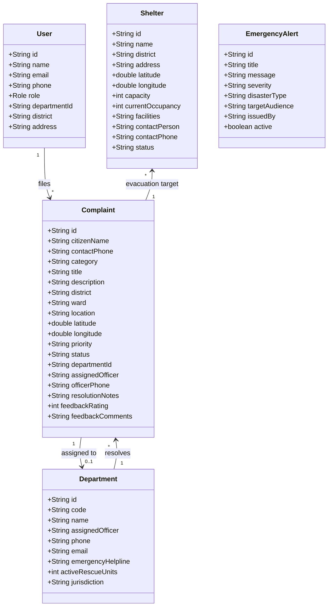

# SOFTWARE REQUIREMENTS SPECIFICATION (SRS)
## Public Disaster Preparedness, Citizen Grievance & Emergency Response System
**Technology Architecture: Enterprise Java Platform (JDK 26)**
**Domain: State & National Disaster Management Authority (Public-Citizen-Government Portal)**

---

### TABLE OF CONTENTS
- **CHAPTER 1 – INTRODUCTION**
  - 1.1 Purpose
  - 1.2 Scope & Public Mission
  - 1.3 Definitions, Acronyms & Abbreviations
  - 1.4 References & NDMA Guidelines
  - 1.5 Document Overview
- **CHAPTER 2 – OVERALL DESCRIPTION**
  - 2.1 Product Perspective (Connecting Citizens, Government DMOC & Response Forces)
  - 2.2 Product Functions
  - 2.3 User Classes & Personas (Public Citizen, Department Responder, Disaster Admin)
  - 2.4 Operating Environment & Concurrency Constraints
  - 2.5 Assumptions & Dependencies
- **CHAPTER 3 – SPECIFIC REQUIREMENTS**
  - 3.1 External Interface Requirements (Interactive Maps, Helplines, Mobile UI)
  - 3.2 Functional Requirements (FR-1 through FR-20)
  - 3.3 Performance Requirements & Virtual Thread Concurrency
  - 3.4 Logical Database Model & Java Entities
  - 3.5 Java Design Constraints & Architecture
  - 3.6 Quality Attributes (Life Safety, Scalability, Reliability)
  - 3.7 Architectural Workflows & Object-Oriented Class Models
- **CHAPTER 4 – APPENDICES**
  - 4.1 System & Runtime Requirements
  - 4.2 Hardware Sizing Specifications
  - 4.3 Future Enhancements (Drone Reconnaissance, Early Siren Grid)

---

## CHAPTER 1 – INTRODUCTION

### 1.1 Purpose
The purpose of this Software Requirements Specification (SRS) document is to specify the architecture and functional requirements for the **Public Disaster Preparedness, Citizen Grievance & Emergency Response System (SafePublic)**.

This system is engineered for the **general public and municipal/state disaster administration**. When any natural or man-made disaster is threatening or actively occurring (such as flash floods, severe inundation, cyclonic storms, gas cylinder leaks, fallen high-voltage lines, or bridge structural damage), citizens can immediately submit an emergency grievance with GPS map coordinates and photos. The platform automatically triages and dispatches the hazard to specialized emergency response departments (NDRF/SDRF, Fire & Rescue, Storm Drainage, Electricity Board, PWD Highways, Emergency Medical Triage, and Police). Simultaneously, the portal serves as a comprehensive public education center, equipping citizens with survival protocols, evacuation maps to open high-ground relief camps, Go-Bag checklists, and 24/7 AI emergency guidance.

### 1.2 Scope & Public Mission
The platform provides a unified life-safety web ecosystem:
- **For Public Citizens:**
  - File disaster grievances with real-time GPS map pinning, threat level classification, and photos.
  - Live progress stepper tracking (`[Reported] -> [Verified by DMOC] -> [Assigned to Dept] -> [Teams Dispatched On Ground] -> [Cleared & Resolved]`).
  - Interactive Leaflet / OpenStreetMap displaying active hazard pins and open high-ground relief shelters with live bed capacities.
  - Public disaster survival encyclopedia (Floods, Cyclones, Earthquakes, Fires, Gas Leaks, Stampedes).
  - 72-Hour Family Emergency Go-Bag interactive checklist.
  - 24/7 Conversational AI emergency assistant for immediate triage and first aid instructions.
- **For Emergency Response Departments (NDRF, Fire, Drainage, Power, PWD, Health, Police):**
  - Department officer dashboard to view tickets within their jurisdiction.
  - Status progression updating (`TEAMS_DISPATCHED`, `RESOLVED`) and field notes logging.
- **For State Disaster Management Operations Center (DMOC Admin):**
  - Multi-channel public siren and red alert broadcasting.
  - Executive disaster situation reports, shelter occupancy monitoring, and response time metrics.

### 1.3 Definitions, Acronyms & Abbreviations
| Term | Meaning |
| :--- | :--- |
| **DMOC** | Disaster Management Operations Center (State/District level command hub). |
| **NDRF / SDRF** | National / State Disaster Response Force (Search, rescue, boat evacuations). |
| **PWD** | Public Works Department (Bridges, roads, structural integrity, landslide clearance). |
| **Discom / TNEB** | State Electricity Board (Emergency power isolation, flood substation safety). |
| **Go-Bag** | 72-hour family emergency survival backpack. |
| **GPS / GIS** | Geographic Information System & Global Positioning Coordinates. |
| **JDK 26** | Java Development Kit 26 with lightweight Virtual Threads (Project Loom). |

---

## CHAPTER 2 – OVERALL DESCRIPTION

### 2.1 Product Perspective
SafePublic connects three primary stakeholders:
1. **Citizens:** Immediate reporting of threatening hazards, tracking rescue operations, and learning survival protocols.
2. **Specialized Response Departments:** Field forces executing on-ground rescue, drainage clearing, and utility isolation.
3. **Government Disaster Management Operations Center (DMOC):** Coordinating multi-agency dispatch, issuing public sirens, and managing relief camps.

### 2.2 Product Functions
1. **Citizen Grievance & Hazard Reporting:**
   - Multi-hazard categories (Flash Flood, Fire/Gas, Structural Collapse, Downed Power Lines, Blocked Drains, Landslides).
   - Priority rating (`IMMEDIATE_THREAT`, `HIGH_ALERT`, `ADVISORY`).
   - Detailed street address, district, ward, and GPS latitude/longitude.
2. **Live Incident Tracking & Feedback:**
   - 5-step visual stepper tracking using unique Complaint Reference IDs.
   - Transparent reporting of assigned officer contact and on-ground status.
   - Post-resolution citizen rating (1-5 stars) and comments.
3. **Interactive Public Disaster & Relief Shelter Map:**
   - Real interactive map with OpenStreetMap tiles.
   - Pinned hazard markers color-coded by urgency.
   - Pinned High-Ground Public Relief Shelters with real-time bed capacity and food/medical facilities.
   - One-click "Find Nearest Safe Shelter & Evacuation Route" calculation.
4. **Public Disaster Survival Learning & Go-Bag:**
   - Step-by-step DOs and DON'Ts for major disaster scenarios.
   - Interactive 72-hour family Go-Bag checklist.
   - Citizen safety certification quizzes.
5. **Emergency Siren Broadcasting:**
   - Flashing Red/Orange siren broadcast banner with synthetic audible siren audio.
6. **24/7 AI Disaster Emergency Advisor:**
   - Rule-based & NLP conversational advisor providing instant first aid, triage, and helpline routing.

---

## CHAPTER 3 – SPECIFIC REQUIREMENTS

### 3.1 Domain Object-Oriented Java Class Models

### 3.2 Functional Requirements

| ID | Requirement | Description |
| :--- | :--- | :--- |
| **FR-1** | Citizen Grievance Filing | The system shall enable citizens to log disaster hazards with GPS coordinates, category, severity, and photo. |
| **FR-2** | Automated Department Dispatch | The system shall automatically route incoming grievances to the designated response force (NDRF, Fire, Drainage, Power, PWD). |
| **FR-3** | Live Stepper Tracking | Citizens shall be able to track their complaint progress through a 5-step visual stepper using their Complaint ID. |
| **FR-4** | Interactive Leaflet GIS Map | The system shall plot real-time hazard pins and open high-ground shelters on an interactive OpenStreetMap. |
| **FR-5** | Nearest Shelter Navigation | The system shall calculate the nearest open relief shelter from the citizen's location and trace the route. |
| **FR-6** | High-Ground Shelter Registry | The system shall maintain live shelter bed availability, food supply, and medical facilities status. |
| **FR-7** | Public Disaster Encyclopedia | The system shall provide illustrated survival guides and DOs & DON'Ts for Floods, Cyclones, Fires, Quakes, and Landslides. |
| **FR-8** | Emergency Go-Bag Checklist | The system shall provide an interactive checklist for family 72-hour disaster survival kits. |
| **FR-9** | Citizen Safety Certification | The system shall evaluate citizen disaster knowledge via timed MCQ quizzes and generate verifiable certificates. |
| **FR-10** | Public Siren Broadcast | The system shall broadcast urgent Red Alert sirens with audio cues across the portal during imminent disasters. |
| **FR-11** | Department Responder Portal | Department officers shall have access to dedicated desks to update on-ground status and dispatch notes. |
| **FR-12** | Citizen Feedback & Rating | Citizens shall be able to rate the speed and quality of resolved grievances with 1-5 stars. |
| **FR-13** | 24/7 AI Emergency Advisor | The system shall deliver real-time emergency guidance, first aid CPR instructions, and hotline numbers. |
| **FR-14** | Multi-Helpline Directory | Instant one-click dialing for 112, 1070, 108, 101, 102, 1913, and electricity boards. |

---

## CHAPTER 4 – APPENDICES

### 4.1 Execution Instructions
- **Run PowerShell:** `.\run.ps1`
- **Run Windows CMD:** `run.bat`
- **Browser URL:** `http://localhost:8080`
